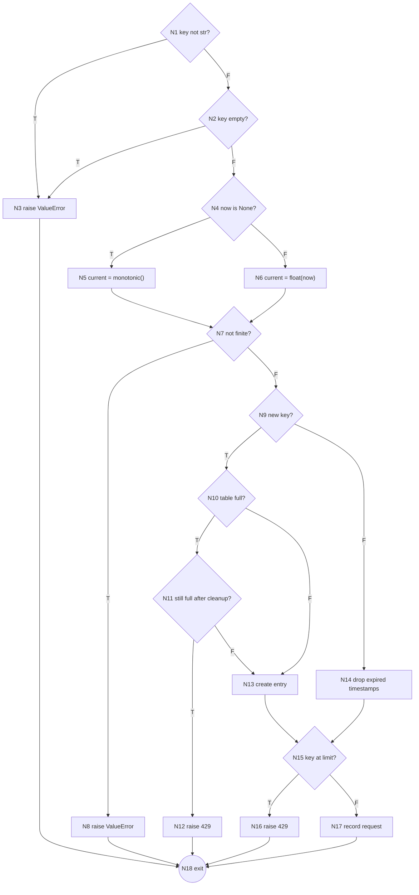
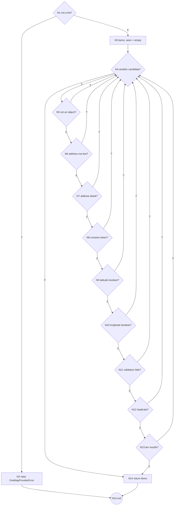

# Lab 4: Test Cases and Testing Results

| | |
|---|---|
| Project | HomeCompass (SC2006) |
| Code tested | the commit that adds this report (parent d74a093), plus the three new test files listed below |
| Run on | 4 November 2026, Python 3.12.13, pytest 8.4.2, macOS |
| Prepared by | Leo, Aryash, Jia Yu |
| AI use | Drafted with Claude Code (AI-assisted). Every case was run and the actual results below are copied from that run. |

This report covers Lab 4 §3.2:

- black-box tests (equivalence classes and boundary values) for one important control class;
- basis-path tests for two methods with complex logic.

Every case is an automated pytest test whose ID matches this report:

| Section | Subject | Test file | Cases |
|---|---|---|---|
| 1 | «control» `ScoringService` → `backend/app/scoring.py` | `backend/tests/test_lab4_scoring_blackbox.py` | 32 |
| 2 | `RateLimiter.check` → `backend/app/rate_limit.py` | `backend/tests/test_lab4_rate_limiter_basis_path.py` | 9 |
| 3 | `_public_map_address_items` → `backend/app/main.py` | `backend/tests/test_lab4_map_address_basis_path.py` | 12 |

To rerun:

```bash
cd backend && python -m pytest -v tests/test_lab4_scoring_blackbox.py tests/test_lab4_rate_limiter_basis_path.py tests/test_lab4_map_address_basis_path.py
```

## Why these subjects

- **ScoringService** is a «control» class in the Lab 3 design class model, with `score(home, request)` and `explain(result)`. It implements FR2 and FR2.1.1, rating and ranking flats, and UC3.1, View ranked candidate homes. In the Python code, `ScoringService` is implemented as the `scoring.py` module rather than a class:
  - `score_distance` and `score_affordability` turn one piece of evidence into a 0–100 component;
  - `score_home_evidence` performs `score()`: it combines the components into the overall score;
  - the `components` list that `score_home_evidence` returns performs `explain()`: each entry gives a component's value, weight, contribution and evidence status.
- **`RateLimiter.check`** implements SRS REQ-1.2, "Authentication attempts must be rate limited". The same class limits address searches to 20 per minute.
- **`_public_map_address_items`** decides which OneMap results the map's address search may show (FR3.2, UC1.2, "Search map location"). It rejects malformed, unsafe or duplicate results before they reach the browser.

## 1. Black-box testing: ScoringService

### 1.1 Specification used for the expected results

Expected outputs come from the published scoring rule (README, "How the home-fit score is calculated"), not from reading the code:

- distance score = `max(0, 100 × (1 − d / t))` for distance `d` ≥ 0 and target `t` > 0, rounded to one decimal place;
- affordability score = `clamp(50 + 50 × (b − p) / b, 0, 100)` for price `p` ≥ 0 and budget `b` > 0;
- invalid input (negative, non-numeric, boolean or non-finite) gives no component score (`None`);
- the overall score is the weighted average of the components that have evidence. Missing evidence is left out, not counted as 0;
- the overall score is shown only when weighted coverage is at least 50%; otherwise it is `None` ("Insufficient evidence");
- default weights are school 2, childcare 2, care 2, affordability 1. Negative weights count as 0.

### 1.2 Equivalence classes

| ID | Input | Class | Valid? | Expected behaviour |
|---|---|---|---|---|
| EC1 | distance `d` | 0 ≤ d < t | valid | partial score, 0 < s ≤ 100 |
| EC2 | distance `d` | d ≥ t | valid | score 0 |
| EC3 | distance `d` | d < 0 | invalid | `None` |
| EC4 | distance `d` | boolean or non-numeric | invalid | `None` |
| EC5 | distance `d` | NaN or infinite | invalid | `None` |
| EC6 | target `t` | t > 0 | valid | score computed |
| EC7 | target `t` | t ≤ 0 | invalid | `None` |
| EC8 | target `t` | non-numeric | invalid | `None` |
| EC9 | price `p` | 0 ≤ p ≤ b | valid | 50–100 |
| EC10 | price `p` | b < p < 2b | valid | 0–50 |
| EC11 | price `p` | p ≥ 2b | valid | 0 |
| EC12 | price `p` | p < 0 | invalid | `None` |
| EC13 | budget `b` | b > 0 | valid | score computed |
| EC14 | budget `b` | b ≤ 0 | invalid | `None` |
| EC15 | weighted coverage | ≥ 50% | valid | overall score returned |
| EC16 | weighted coverage | 0 < coverage < 50% | valid | overall score `None` |
| EC17 | weighted coverage | 0 (no evidence) | valid | score `None`, all components missing |
| EC18 | weights | not supplied | valid | defaults 2/2/2/1 |
| EC19 | weights | supplied, non-negative | valid | used as relative weights |
| EC20 | weights | all zero | invalid | score `None`, coverage 0 |
| EC21 | weights | one negative | invalid | that weight treated as 0 |

### 1.3 Boundaries

| Input | Boundary values tested (school target t = 1,500 m, budget b = 100) |
|---|---|
| distance | −0.1 (just below the minimum), 0 (minimum), 0.1 (just above the minimum), 750 (nominal), 1,499 (t − 1), 1,500 (t), 1,501 (t + 1) |
| target | −0.1, 0, 0.1 (new cases use distance 0 to isolate target validity) |
| price | −1, 0, 1, 99 (b − 1), 100 (b), 101 (b + 1), 199 (2b − 1), 200 (2b), 201 (2b + 1) |
| budget | −1, 0, 1 (new cases use price 0 to isolate budget validity) |
| coverage | 0.4975 (just below 50%), 0.5 (exactly 50%), 0.5025 (just above 50%) |

### 1.4 Keeping the number of cases small

- Valid classes are combined in the same case where possible. For example, BB-01 covers EC1 and EC6, and BB-19 covers EC15 and EC18 with all four components at once.
- Invalid inputs are isolated so a failure points to a single cause. BB-27 and BB-31 add the negative side of the target and budget boundaries already tested at zero.
- Boundary values are tested only where the specification has a boundary: zero, the target, the budget, twice the budget, and 50% coverage. Each gets the value just below, on and just above it.
- The 50% coverage boundary is reached with weights 1/1/1/0.98. With equal weights, coverage can only be 0, 25, 50, 75 or 100%, so it could never land just either side of 50%.

### 1.5 Test cases and results

Targets are school 1,500 m, childcare 2,000 m and care 2,000 m, unless stated otherwise.

| ID | Test input | Covers | Expected output | Actual output | Result |
|---|---|---|---|---|---|
| BB-01 | `score_distance(0, 1500)` | EC1, EC6, minimum | 100.0 | 100.0 | Pass |
| BB-02 | `score_distance(750, 1500)` | EC1, nominal | 50.0 | 50.0 | Pass |
| BB-03 | `score_distance(1499, 1500)` | EC1, t − 1 | 0.1 | 0.1 | Pass |
| BB-04 | `score_distance(1500, 1500)` | EC2, t | 0.0 | 0.0 | Pass |
| BB-05 | `score_distance(1501, 1500)` | EC2, t + 1 | 0.0 | 0.0 | Pass |
| BB-06 | `score_distance(-0.1, 1500)` | EC3, just below 0 | `None` | `None` | Pass |
| BB-07 | `score_distance(True, 1500)` | EC4 | `None` | `None` | Pass |
| BB-08 | `score_distance(NaN, 1500)` | EC5 | `None` | `None` | Pass |
| BB-09 | `score_distance(100, 0)` | EC7, target 0 | `None` | `None` | Pass |
| BB-10 | `score_distance(100, "1500")` | EC8 | `None` | `None` | Pass |
| BB-11 | `score_affordability(0, 100)` | EC9, EC13, minimum | 100.0 | 100.0 | Pass |
| BB-12 | `score_affordability(99, 100)` | EC9, b − 1 | 50.5 | 50.5 | Pass |
| BB-13 | `score_affordability(100, 100)` | EC9, b | 50.0 | 50.0 | Pass |
| BB-14 | `score_affordability(101, 100)` | EC10, b + 1 | 49.5 | 49.5 | Pass |
| BB-15 | `score_affordability(200, 100)` | EC11, 2b | 0.0 | 0.0 | Pass |
| BB-16 | `score_affordability(201, 100)` | EC11, 2b + 1 | 0.0 | 0.0 | Pass |
| BB-17 | `score_affordability(-1, 100)` | EC12, just below 0 | `None` | `None` | Pass |
| BB-18 | `score_affordability(50, 0)` | EC14, budget 0 | `None` | `None` | Pass |
| BB-19 | All evidence: school 600 m, childcare 500 m, care 1,000 m; price $450,000 against a $500,000 budget; default weights | EC15, EC18 | components 60.0 / 75.0 / 50.0 / 55.0; score (2·60 + 2·75 + 2·50 + 55) ÷ 7 = **60.7**; coverage 1.0; contributions sum to 60.7 | score 60.7; coverage 1.0; contributions 17.1 + 21.4 + 14.3 + 7.9 | Pass |
| BB-20 | School 0 m and childcare 1,000 m only; weights 1/1/1/1 | EC15 at exactly 50%, EC19 | score (100 + 50) ÷ 2 = **75.0** (not 37.5, so missing ≠ 0); coverage 0.5; missing: care, affordability | 75.0; 0.5; [care, affordability] | Pass |
| BB-21 | School 0 m, price 50 against budget 100; weights 1/1/1/0.98 | EC16, coverage 0.4975 | score `None` | score `None`; coverage reported as 0.5 | Pass |
| BB-22 | School 0 m, childcare 1,000 m; weights 1/1/1/0.98 | EC15, coverage 0.5025 | score 75.0 | 75.0; coverage reported as 0.5 | Pass |
| BB-23 | No evidence; default weights | EC17 | score `None`; coverage 0.0; all four missing | as expected | Pass |
| BB-24 | All evidence; all weights 0 | EC20 | score `None`; coverage 0.0 | as expected | Pass |
| BB-25 | All evidence as BB-19; school weight −5, others 1 | EC21 | school weight 0; score (75 + 50 + 55) ÷ 3 = **60.0** | weight 0.0, contribution 0.0; score 60.0 | Pass |

**Finding from BB-21 and BB-22.** The result rounds coverage to two decimal places, so 49.75% and 50.25% are both reported as 0.5 ("Coverage 50%"). The scoring decision is correct: one home has a score and the other is "Insufficient evidence". But a user could see "Coverage 50%" next to "Insufficient evidence". Showing one more decimal place, or rounding down, would remove the contradiction. This is a presentation issue, not a scoring defect, and it is recorded here rather than fixed.

### 1.6 Boundary coverage additions (10 November 2026, SGT)

BB-26 to BB-32 complete the missing sides of the boundaries identified in §1.3. The original BB-01 to BB-25 and all basis-path cases are unchanged.

| ID | Test input | Boundary | Expected output | Actual output | Result |
|---|---|---|---|---|---|
| BB-26 | `score_distance(0.1, 1500)` | just above minimum distance | 100.0 after rounding | 100.0 | Pass |
| BB-27 | `score_distance(0, -0.1)` | target just below zero | `None` | `None` | Pass |
| BB-28 | `score_distance(0, 0.1)` | target just above zero | 100.0 | 100.0 | Pass |
| BB-29 | `score_affordability(1, 100)` | price just above zero | 99.5 | 99.5 | Pass |
| BB-30 | `score_affordability(199, 100)` | just below twice the budget | 0.5 | 0.5 | Pass |
| BB-31 | `score_affordability(0, -1)` | budget just below zero | `None` | `None` | Pass |
| BB-32 | `score_affordability(0, 1)` | budget just above zero | 100.0 | 100.0 | Pass |

## 2. Basis-path testing: `RateLimiter.check`

### 2.1 Code and flow-graph nodes

Simplified excerpt of `backend/app/rate_limit.py`, lines 76–102: some statements are shortened, and the node labels are added as comments. Each compound condition is split into simple conditions, so every predicate node tests one condition.

```python
def check(self, key, now=None):
    if not isinstance(key, str) or not key:                 # N1: not str?  N2: empty?
        raise ValueError("key must be a non-empty string")   # N3
    current = monotonic() if now is None else float(now)     # N4: now is None?  N5 / N6
    if not isfinite(current):                               # N7
        raise ValueError("now must be a finite monotonic time")  # N8
    cutoff = current - self.window_seconds
    with self._lock:
        requests = self._requests.get(key)
        if requests is None:                                 # N9: new key?
            if len(self._requests) >= self.max_entries:      # N10: table full?
                self._remove_expired(cutoff)
                if len(self._requests) >= self.max_entries:  # N11: still full?
                    retry_after = min(...)                   # N12
                    self._raise_limited(retry_after)
            requests = deque()                               # N13
            self._requests[key] = requests
        else:
            self._remove_expired_from(requests, cutoff)      # N14
        if len(requests) >= self.max_requests:               # N15: key at limit?
            self._raise_limited(...)                         # N16
        requests.append(current)                             # N17
                                                             # N18: exit
```

### 2.2 Flow graph



### 2.3 Cyclomatic complexity

- Edges E = 25, nodes N = 18, so V(G) = E − N + 2 = 25 − 18 + 2 = **9**.
- Predicate nodes P = 8 (N1, N2, N4, N7, N9, N10, N11, N15), so V(G) = P + 1 = **9**.

### 2.4 Basis paths, test cases and results

BP1-1 is the baseline. Each later path flips one decision and adds at least one edge not used before. Unless stated otherwise, the limiter allows 2 requests per 10-second window.

| ID | Path | New edge | Test input | Expected output | Actual output | Result |
|---|---|---|---|---|---|---|
| BP1-1 | 1-2-4-6-7-9-10-13-15-17-18 | baseline | new key `"a"`, now = 0 | request recorded at time 0 | `[0.0]` recorded | Pass |
| BP1-2 | 1-3-18 | 1→3 | key = 42 | ValueError "key must be a non-empty string" | ValueError raised | Pass |
| BP1-3 | 1-2-3-18 | 2→3 | key = `""` | ValueError "key must be a non-empty string" | ValueError raised | Pass |
| BP1-4 | 1-2-4-5-7-9-10-13-15-17-18 | 4→5 | key `"a"`, no `now` | request recorded using the system clock | 1 request recorded | Pass |
| BP1-5 | 1-2-4-6-7-8-18 | 7→8 | now = infinity | ValueError "now must be a finite monotonic time" | ValueError raised | Pass |
| BP1-6 | 1-2-4-6-7-9-14-15-17-18 | 9→14 | `"a"` at 0, then `"a"` at 1 | both recorded | `[0.0, 1.0]` | Pass |
| BP1-7 | 1-2-4-6-7-9-10-11-13-15-17-18 | 10→11, 11→13 | 1-key table: `"a"` at 0, then `"b"` at 11 | `"a"` has expired and is removed; `"b"` recorded | table = {`"b"`} | Pass |
| BP1-8 | 1-2-4-6-7-9-10-11-12-18 | 11→12 | 1-key table: `"a"` at 0, then `"b"` at 5 | HTTP 429, Retry-After = ⌈0 + 10 − 5⌉ = 5; table unchanged | 429, Retry-After "5", table = {`"a"`} | Pass |
| BP1-9 | 1-2-4-6-7-9-14-15-16-18 | 15→16 | `"a"` at 0, 1, then 2 | HTTP 429, RATE_LIMITED, Retry-After = ⌈0 + 10 − 2⌉ = 8 | 429, RATE_LIMITED, Retry-After "8" | Pass |

`min(...)` in N12 loops over the table internally. It is treated as one statement, because it computes a value and makes no control decision in `check`.

## 3. Basis-path testing: `_public_map_address_items`

### 3.1 Code and flow-graph nodes

Simplified excerpt of `backend/app/main.py`, lines 2034–2075: several statements are combined onto one line, and the node labels are added as comments.

```python
def _public_map_address_items(candidates, provider_token):
    if not isinstance(candidates, list):                     # N1
        raise OneMapProviderError(...)                       # N2
    items, seen = [], set()                                  # N3
    for candidate in candidates:                             # N4: another candidate?
        if not isinstance(candidate, dict): continue         # N5
        address = candidate.get("address")
        if not isinstance(address, str): continue            # N6
        address = " ".join(address.split())
        if not address                                       # N7: blank?
           or provider_token.casefold() in address.casefold():   # N8: leaks token?
            continue
        latitude, longitude = candidate.get(...), candidate.get(...)
        if isinstance(latitude, bool)                        # N9
           or isinstance(longitude, bool): continue          # N10
        try: place = PersonalPlaceRequest.model_validate(...)    # N11: valid Singapore point?
        except (...): continue
        key = (address.casefold(), lat, lng)
        if key in seen: continue                             # N12: duplicate?
        seen.add(key); items.append({...})
        if len(items) == 10: break                           # N13: ten results?
    return items                                             # N14
                                                             # N15: exit
```

### 3.2 Flow graph



### 3.3 Cyclomatic complexity

- Edges E = 25, nodes N = 15, so V(G) = E − N + 2 = 25 − 15 + 2 = **12**.
- Predicate nodes P = 11 (N1 and N4–N13), so V(G) = P + 1 = **12**.

### 3.4 Basis paths, test cases and results

A valid candidate is `{"address": "10 Example Road", "latitude": 1.3, "longitude": 103.85}`, and the provider token is `tok123`.

| ID | Path | New edge | Test input | Expected output | Actual output | Result |
|---|---|---|---|---|---|---|
| BP2-1 | 1-3-4-5-6-7-8-9-10-11-12-13-4-14-15 | baseline | `[valid]` | one item with `provider: "OneMap"` | one item, as expected | Pass |
| BP2-2 | 1-2-15 | 1→2 | `{"results": [valid]}` (not a list) | OneMapProviderError | raised | Pass |
| BP2-3 | 1-3-4-14-15 | loop runs 0 times | `[]` | `[]` | `[]` | Pass |
| BP2-4 | 1-3-4-5-4-14-15 | 5→4 | `["10 Example Road"]` | `[]` | `[]` | Pass |
| BP2-5 | 1-3-4-5-6-4-14-15 | 6→4 | address = 10 | `[]` | `[]` | Pass |
| BP2-6 | 1-3-4-5-6-7-4-14-15 | 7→4 | address = `"   "` | `[]` | `[]` | Pass |
| BP2-7 | 1-3-4-5-6-7-8-4-14-15 | 8→4 | address = `"10 TOK123 Road"` | `[]` (case-insensitive token match) | `[]` | Pass |
| BP2-8 | 1-3-4-5-6-7-8-9-4-14-15 | 9→4 | latitude = `True` | `[]` | `[]` | Pass |
| BP2-9 | 1-3-4-5-6-7-8-9-10-4-14-15 | 10→4 | longitude = `False` | `[]` | `[]` | Pass |
| BP2-10 | 1-3-4-5-6-7-8-9-10-11-4-14-15 | 11→4 | latitude = 1.6 (outside Singapore) | `[]` | `[]` | Pass |
| BP2-11 | 1-3-4-5-6-7-8-9-10-11-12-13-4-5-6-7-8-9-10-11-12-4-14-15 | 12→4 | `[valid, "  10   Example Road "]` | one item; whitespace-normalised duplicate dropped | one item | Pass |
| BP2-12 | 1-3-(4-5-6-7-8-9-10-11-12-13)×9-4-5-6-7-8-9-10-11-12-13-14-15 | 13→14 | 11 distinct valid addresses | first 10 returned | addresses 1–10 | Pass |

In BP2-12, `(…)×9` means the loop body runs nine times, returning to N4 each time, before the tenth pass takes the 13→14 edge.

BP2-3 adds no new edge, but it is still part of the basis: it is the zero-iteration path. Every looping path is this path plus one cycle through the loop body. With it, the 12 paths are linearly independent, matching V(G) = 12.

## 4. Execution summary

The table below records the original run before the seven boundary cases were added. On 10 November 2026 (SGT), the three Lab 4 test files were rerun on base `b6ea252` with the boundary additions: **53 passed** (32 scoring cases and 21 basis-path cases). This is a focused rerun, not a new full backend-suite result.

| Run | Command | Result |
|---|---|---|
| New Lab 4 cases | `python -m pytest -v` on the three files | **46 passed, 0 failed** (25 black-box, 9 + 12 basis-path) |
| Whole backend suite | `cd backend && python -m pytest -q` | **541 passed, 4 skipped**. The 4 skipped tests need a dedicated test database; they also skipped before these tests were added. |

### 4.1 Checking the paths were really taken

`Lab4/evidence/trace_basis_paths.py` runs the basis-path tests and records which lines of each method every test executes. Run it from the repository root with `.venv/bin/python Lab4/evidence/trace_basis_paths.py`. It showed:

- Each test reached its intended branch.
- Together, the tests executed every statement of `_public_map_address_items`.
- In `RateLimiter.check`, the script reports one line as never executed: line 91, the expression inside `min(...)`. Python runs a generator expression as a separate code object, so the tracer does not attribute it to `check`. BP1-8 does run it: the test receives the Retry-After value of 5 that this expression computes.
- BP1-4 runs the same lines as BP1-1, because the `now is None` choice is written on one line. BP1-4 proves that branch through its assertion instead: the request is recorded even though no time was passed in.

### 4.2 Checking the tests can catch faults

`Lab4/evidence/seeded_faults.py` copies the backend to a temporary folder, seeds one fault at a time, and runs the new tests against each faulty copy. The repository itself is never changed. Run it from the repository root with `.venv/bin/python Lab4/evidence/seeded_faults.py`:

| Seeded fault | Tests that failed |
|---|---|
| Coverage threshold `>=` changed to `>` | 1 (BB-20) |
| Rate-limit check `>=` changed to `>` | 1 (BP1-9) |
| Result cap `== 10` changed to `== 11` | 1 (BP2-12) |
| Affordability midpoint 50 changed to 40 | 6 (BB-11 to BB-14, BB-19, BB-25). BB-15 and BB-16 still pass, because both results clamp to 0 either way. |

Every seeded fault was detected.
