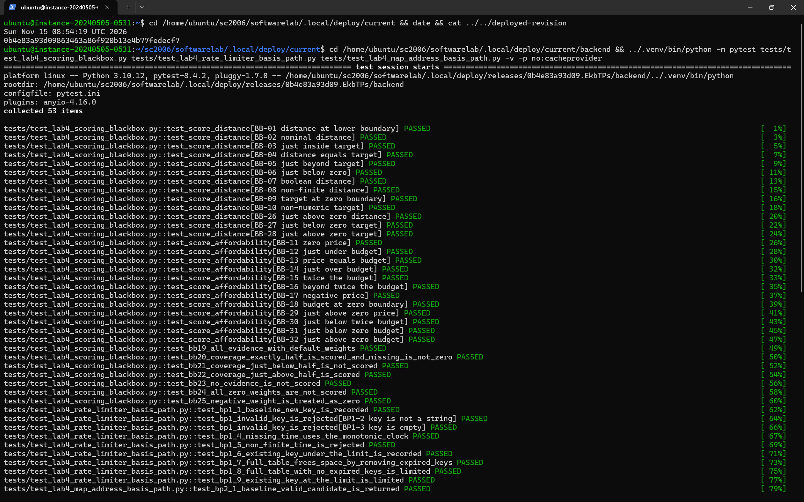
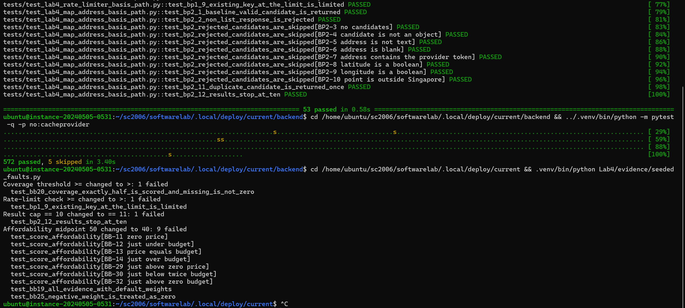

# Lab 4 test results on the deployed release

The team reran the Lab 4 tests on 15 November 2026 (SGT) using deployed revision `0b4e83a93d09863463a86f920b13e4b77fedecf7`, Python 3.10.12 and pytest 8.4.2 on Linux. The results below are transcribed from the terminal captures. See the [Lab 4 test case report](../Lab4/Test_Cases_and_Results.md) for case IDs, inputs and expected outcomes.

| Test group | Passed | Failed | Skipped |
| --- | ---: | ---: | ---: |
| [Scoring black-box cases](../backend/tests/test_lab4_scoring_blackbox.py) | 32 | 0 | 0 |
| [Rate limiter basis paths](../backend/tests/test_lab4_rate_limiter_basis_path.py) | 9 | 0 | 0 |
| [Map address basis paths](../backend/tests/test_lab4_map_address_basis_path.py) | 12 | 0 | 0 |
| **Focused Lab 4 run (0.58 s)** | **53** | **0** | **0** |
| **Full backend suite (3.40 s)** | **572** | **0** | **5** |

## Seeded-fault results

The [seeded-fault script](../Lab4/evidence/seeded_faults.py) introduced one deliberate change at a time in a temporary copy. Each fault triggered the expected test failures.

| Deliberate change | Tests that detected the fault |
| --- | --- |
| Minimum scoring coverage comparison changed from `>=` to `>` | 1 (BB-20) |
| Rate-limit comparison changed from `>=` to `>` | 1 (BP1-9) |
| Address result cap changed from 10 to 11 | 1 (BP2-12) |
| Affordability midpoint changed from 50 to 40 | 9 (BB-11–BB-14, BB-19, BB-25, BB-29, BB-30, BB-32) |

## Terminal screenshots

**Focused Lab 4 run.** Deployed revision, Python and pytest versions, and individual case results.



**Run summaries and seeded faults.** The focused run passed all 53 cases, the full backend suite passed 572 tests with 5 skipped, and all four deliberate changes were detected.



## Reproduce the runs

With the backend virtual environment active, run the following from the repository root.

```sh
cd backend
python -m pytest -v -p no:cacheprovider tests/test_lab4_scoring_blackbox.py tests/test_lab4_rate_limiter_basis_path.py tests/test_lab4_map_address_basis_path.py
python -m pytest -q -p no:cacheprovider
cd ..
python Lab4/evidence/seeded_faults.py
```
